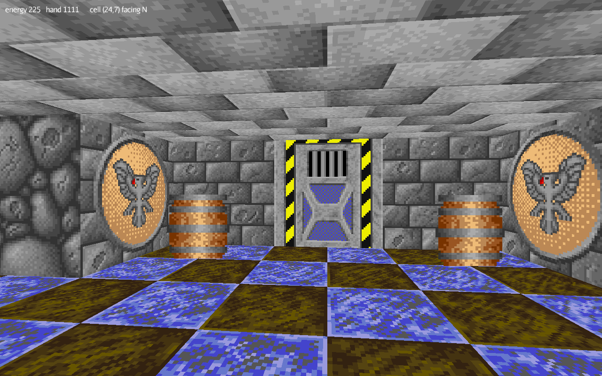

# Citadel — Java / jMonkeyEngine port

A port of the 1995 Amiga game **Citadel** by Virtual Design, rebuilt in Java on
[jMonkeyEngine](https://jmonkeyengine.org/). The original 68000 assembly sources and game data are
included in `Code/` and `Data/` and are the reference the port is derived from.

The original is a cell-based software renderer: a 64 × 64 grid of 1024-unit cells, walls drawn as
textured trapezoids back to front from a precomputed visibility table, all integer arithmetic,
output as chunky pixels and converted to five Amiga bitplanes. The port drops that rendering path
entirely — jMonkeyEngine draws real 3D — and keeps what actually matters: the data formats and the
game rules, taken from the assembly rather than reinvented.



## Running it

Needs a JDK 21 toolchain. Gradle downloads jMonkeyEngine on first build.

```sh
gradle :tools:convert     # convert the original data into build/assets
gradle :game:run          # walk around LEVEL01A
gradle :game:run --args=LEVEL05B
```

Conversion has to run once before the game: the viewer loads its textures from `build/assets`,
while level data is read straight out of the original `.MAP` files.

**Controls** — mouse turns, `W`/`S` walk, `A`/`D` strafe, `E` or right mouse button uses the wall you are
facing, left mouse or `Ctrl` fires, `1`..`6` pick a weapon and `0` goes back to the bare hand. `M` toggles the automap.

## What works

- All 28 levels and all 8 texture sets load and render: walls, sliding doors, floors, ceilings,
  columns, items and both enemy species.
- Movement and collision follow the original rules, not a physics engine: the 307-unit player
  radius, clamp-after-move sliding, corner handling, blocking columns.
- Doors open by themselves as you approach and shut behind you, one of each type at a time.
- Wall switches run their command lists (open/close door, set/remove block, swap wall, item or
  column), teleports work, reaching the exit cell ends the level.
- Items are picked up with the original's rules and fill a working inventory: weapons, ammunition,
  keycards, first aid, speed boost, vodka, warhead sections.
- Enemies are simulated in the 24 × 24 cells around the player: they roam, close in, take line of
  sight into account, and shoot.
- Weapons fire: hitscan resolution like the original, ammunition, weapon wear, and the 4-bit
  vulnerability mask that makes some species immune to some damage types.
- Sound: the 25 effects play, positioned in the world for doors and enemies.
- The intro animations decode. The original README says they were lost; they are not.
- The 21-level campaign runs end to end: reaching the exit loads the next map and carries your
  inventory across, following the server's ETAPY table.
- Messages are the original ones, random variants and all, read from `TEXT.ENG`.
- Automap (press `M`), level clock, low-energy warning, and dying when energy runs out.

## What is missing

- Travelling projectiles (`Anim_Objects`): rocket splash damage and flame trails.
- Compass and the original HUD layout; the menu, briefing and save screens (`SERVER`).
- The intro sequence itself: the animations decode to PNG frames, but nothing plays them in-game.
- Death sequence, and the menu and briefing screens.

`PORTING.md` keeps an honest list of the known gaps.

## Layout

| module | contents | dependencies |
|---|---|---|
| `core` | data formats, level model, game rules | none |
| `tools` | asset converter and inspectors | `core`, `java.desktop` |
| `game` | jMonkeyEngine front end | `core`, jME 3.9 |

`core` has no dependency on jMonkeyEngine or on `java.desktop`, so the whole rule set runs
headless. `gradle :core:test` exercises it against the shipped maps, including a random walk of
20 000 steps across five levels asserting the player never ends up on the far side of a shut door.

## Documentation

- **[PORTING.md](PORTING.md)** — coordinate system, movement rules, where the port deliberately
  departs from the original, and the current state.
- **[tools/README.md](tools/README.md)** — every original data format, decoded, with the assembly
  label that proves each claim.

Two things were not written down anywhere and had to be worked out: `.VIR` graphics are stored
column-major with a 65-byte stride, and the colour index is bit-reversed into bits 3..7 of each
byte because the chunky-to-planar macro consumes bit 7 first. Cell values index the engine's
sprite tables 1-based.

## Credits and licence

Citadel is Copyright © 1995, 2022 Virtual Design. Original code by Kane of Suspect.

The original sources come from [pawelmat/Amiga-Citadel](https://github.com/pawelmat/Amiga-Citadel).

This package is free to copy and use for non-commercial purposes under the terms of the
**GNU GPL-3.0** licence; see [LICENSE](LICENSE). It comes with absolutely no warranty of any kind.
