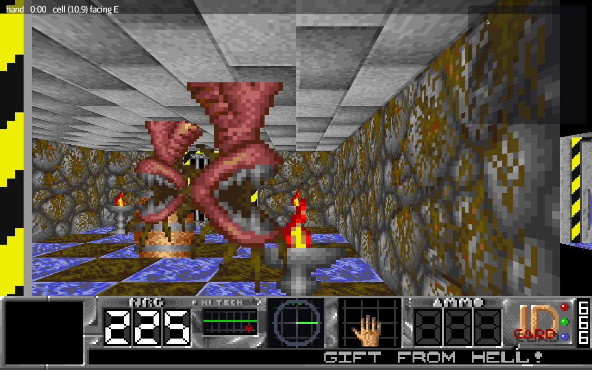
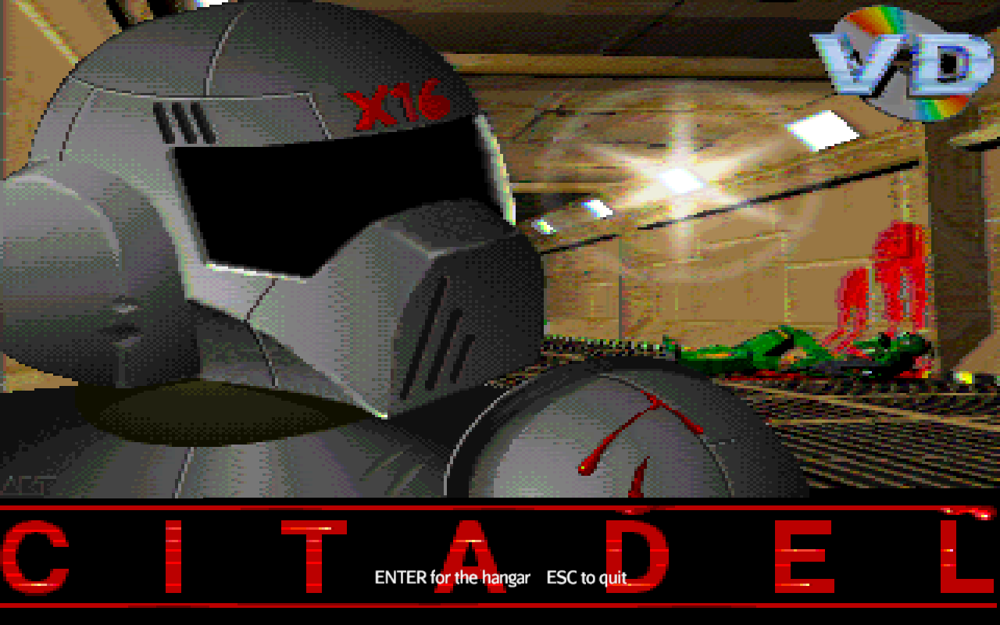
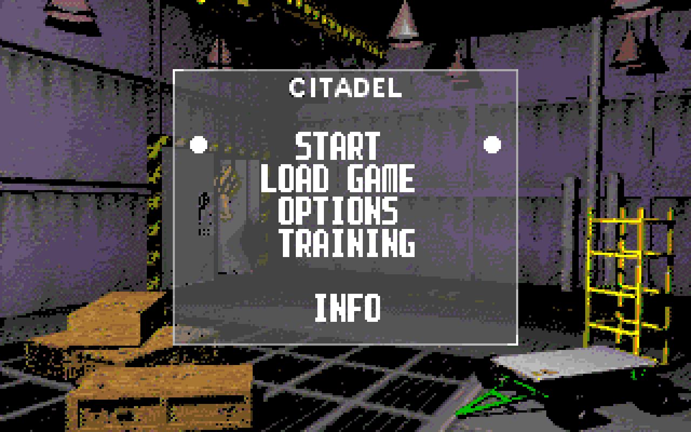
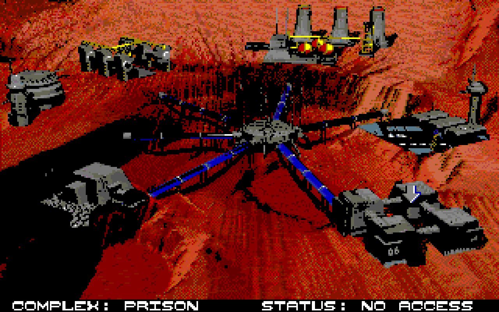
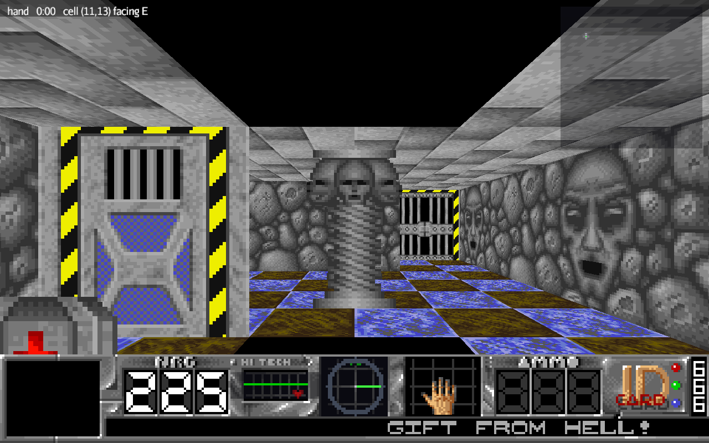
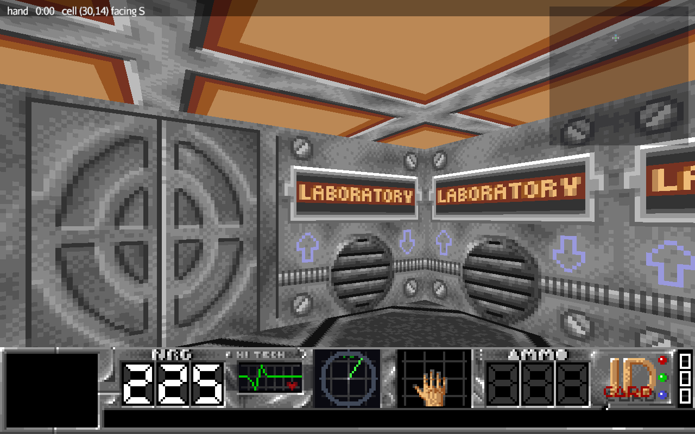
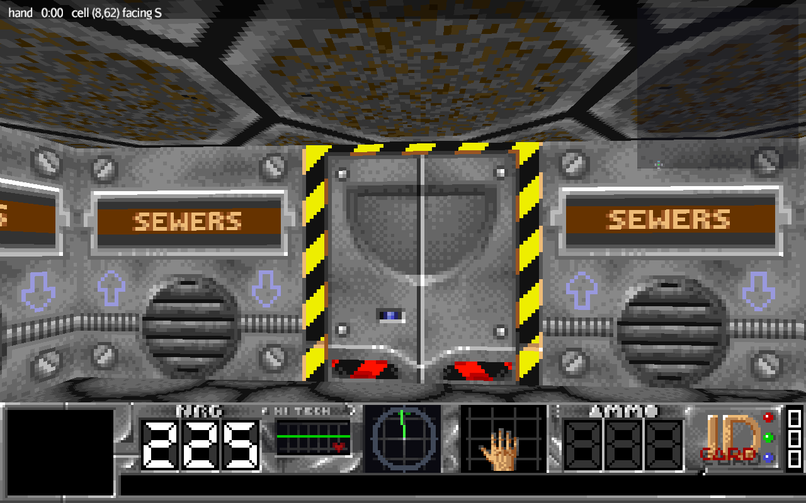
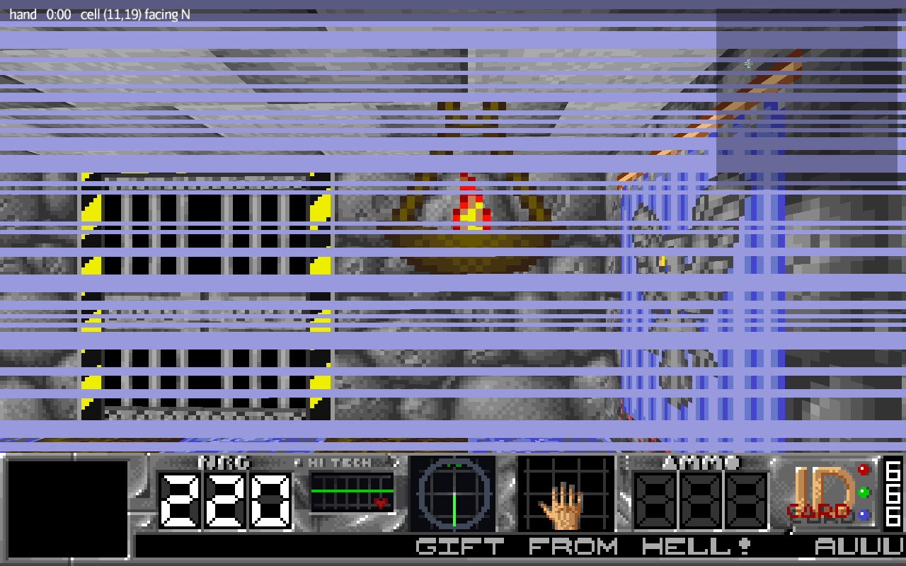
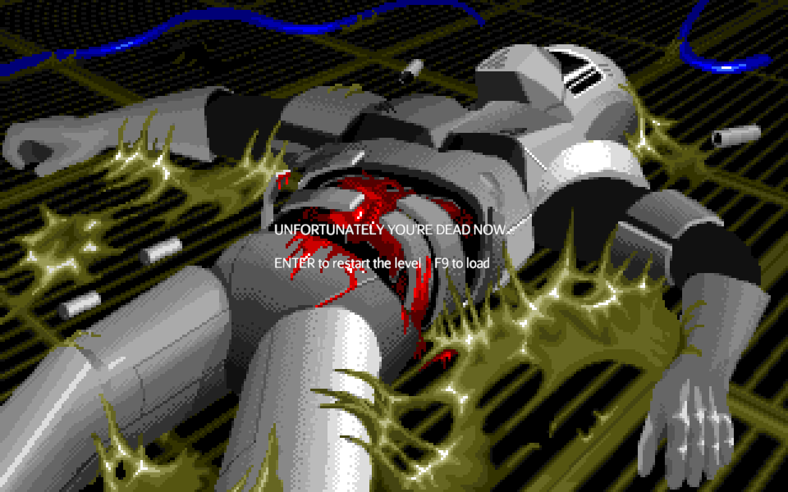
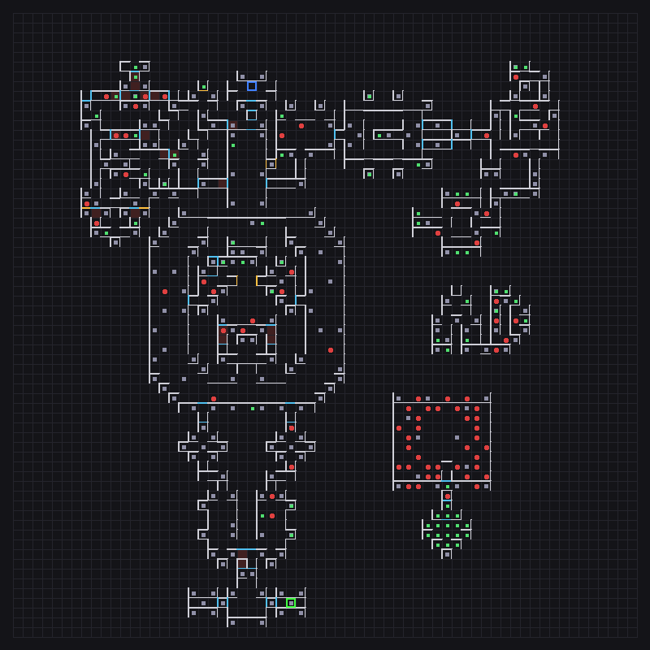

# Citadel — Java / jMonkeyEngine port

A port of the 1995 Amiga first-person shooter **Citadel** by Virtual Design, rebuilt in Java on
[jMonkeyEngine](https://jmonkeyengine.org/). Every rule, table and data format comes from the
original 68000 assembly rather than being reinvented; only the renderer is new.



The original is a cell-based software renderer: a 64 × 64 grid of 1024-unit cells, walls drawn as
textured trapezoids back to front from a precomputed visibility table, all integer arithmetic,
output as chunky pixels and converted to five Amiga bitplanes. The port drops that rendering path
entirely — jMonkeyEngine draws real 3D — and keeps what actually matters: the data formats and the
game rules.

## Screenshots

<table>
  <tr>
    <td></td>
    <td></td>
  </tr>
  <tr>
    <td align="center"><sub>The title screen, after the intro animation</sub></td>
    <td align="center"><sub>The server's menu, in its own font, over the hangar</sub></td>
  </tr>
  <tr>
    <td></td>
    <td></td>
  </tr>
  <tr>
    <td align="center"><sub>MAPA, choosing the next complex to attack</sub></td>
    <td align="center"><sub>A column of skulls, a carved face and a first aid kit</sub></td>
  </tr>
  <tr>
    <td></td>
    <td></td>
  </tr>
  <tr>
    <td align="center"><sub>The laboratory: each complex has its own texture set</sub></td>
    <td align="center"><sub>The sewers</sub></td>
  </tr>
  <tr>
    <td></td>
    <td></td>
  </tr>
  <tr>
    <td align="center"><sub>The interference burst when a shot lands</sub></td>
    <td align="center"><sub>The original death picture</sub></td>
  </tr>
</table>

## Playing

### From a package

`gradle :game:jpackage` builds a self-contained folder with its own Java runtime (see
[Packaging](#packaging)). It holds no game data: on first start it offers to download the
original data from [Amiga-Citadel](https://github.com/pawelmat/Amiga-Citadel), or to use a copy
already on disk, and converts it once.

### From source

Needs a JDK 21 toolchain and the original data, which is not part of this repository: check out
Amiga-Citadel next to it, so that its `Code/` and `Data/` sit in `../Amiga-Citadel`, or point the
build elsewhere with `-Poriginal=<path>`. Gradle downloads jMonkeyEngine on first build.

```sh
git clone https://github.com/pawelmat/Amiga-Citadel ../Amiga-Citadel
gradle :tools:convert              # convert the original data into build/assets
gradle :game:run                   # start from the intro
gradle :game:run --args=LEVEL05B   # or straight into a level
```

Conversion has to run once before the game: textures and sounds come from `build/assets`, while
level data is read straight out of the original `.MAP` files.

### Controls

| key | action |
|---|---|
| mouse | turn |
| `W` `S` / `A` `D` | walk / strafe |
| `E`, right mouse button | use the wall you are facing |
| left mouse button, `Ctrl` | fire |
| `1` … `6`, `0` | pick a weapon, back to the bare hand |
| `M` | automap |
| `Z` | interference off |
| `-` `+` | game pace |
| `F5` / `F9` | save / load menu |

The original's seven cheat codes work too; [PORTING.md](PORTING.md#the-cheat-codes) explains how
they were recovered from the obfuscated tables.

## What works

- **The world** — all 28 levels and all 8 complexes: walls, sliding doors, floors, ceilings,
  animated walls and columns, blood stains and plaques, items and both enemy species.
- **Movement** follows the original rules, not a physics engine: the 307-unit player radius,
  clamp-after-move sliding, corner handling, blocking columns, and the energy it costs to walk
  into a wall.
- **Doors and switches** — doors open as you approach and shut behind you; wall switches run
  their command lists; teleports dissolve the view with the original chaos table.
- **Combat** — enemies roam, close in, respect line of sight and shoot back; weapons fire hitscan
  or real projectiles (fireballs, electricity, rockets that burst into fireballs), with ammunition,
  weapon wear and the per-species vulnerability mask.
- **Inventory** — weapons, ammunition, keycards, first aid, speed boost, vodka, and the six
  warhead sections with their assembly gauge.
- **Status panel** — the original panel with every widget where the engine puts it: energy,
  heart monitor and the exhaustion behind it, compass, weapon reveal, ammunition, ID cards, and
  the scrolling message line with the original texts.
- **Campaign** — the intro, the title screen, the server's menu in the hangar, MAPA between
  complexes, the level sequence with the inventory carried across, the death sequence, and the
  victory card.
- **Sound** — the 25 effects, positioned in the world for doors and enemies.
- **Saves** — a five-slot menu over the original 768-byte `Savegame.DAT` format.

Not done yet: the pushes that go with a hit (`sv_AddMove` and the `sv_LastMove` rebound).
[PORTING.md](PORTING.md#state) keeps the full list.

## How it is built

| module | contents | dependencies |
|---|---|---|
| `core` | data formats, level model, game rules | none |
| `tools` | asset converter and inspectors | `core`, `java.desktop` |
| `game` | jMonkeyEngine front end | `core`, `tools`, jME 3.9 |

`core` has no dependency on jMonkeyEngine or on `java.desktop`, so the whole rule set runs
headless. `gradle :core:test` exercises it against the shipped maps, including a random walk of
20 000 steps across five levels asserting the player never ends up on the far side of a shut door.



The converter also writes a readable dump and an overview of every level into
`build/assets/maps` — walls in white, doors in blue, switches in amber, columns in grey, items in
green, enemies in red, the spawn as a blue square and the exit as a green one — which is how the
decoding was checked against the game.

Two things were not written down anywhere and had to be worked out: `.VIR` graphics are stored
column-major with a 65-byte stride, and the colour index is bit-reversed into bits 3..7 of each
byte because the chunky-to-planar macro consumes bit 7 first. Cell values index the engine's
sprite tables 1-based.

For verification without a window in the way, `gradle :game:shot` renders one frame to
`build/shots` and exits: `-Plevel=LEVEL03C`, `-Pscreen=title|hangar|map|dead|victory`,
`-Pat=x,y,angle`, `-Pcheat=HOTKISS`. Every screenshot on this page was made that way.

<br clear="right">

## Packaging

```sh
gradle :game:jpackage              # a self-contained folder in game/build/jpackage/Citadel
gradle :game:jpackage -Ptype=msi   # a Windows installer, which needs the WiX toolset
```

The result carries its own Java runtime and the game, but no game data: about 80 MB, most of it
the runtime. Two things keep that from being twice the size — `--add-modules` so jlink strips the
JDK down to what jME actually uses, and dropping the LWJGL natives for every platform except the
one being built for.

On first start the game asks whether to download the original data from
[Amiga-Citadel](https://github.com/pawelmat/Amiga-Citadel) (pinned to the commit the port was
checked against, about 20 MB), or to use a checkout already on disk. It then converts it once, and
keeps the data, the converted assets and the save file in a per-user folder:
`%LOCALAPPDATA%\Citadel` on Windows, `~/Library/Application Support/Citadel` on macOS,
`~/.local/share/citadel` elsewhere. Delete that folder to start over.

## Documentation

- **[PORTING.md](PORTING.md)** — coordinate system, movement rules, every ported routine with the
  assembly labels it comes from, where the port deliberately departs from the original, and the
  current state.
- **[tools/README.md](tools/README.md)** — every original data format, decoded, with the assembly
  label that proves each claim.

## Credits and licence

Citadel is Copyright © 1995, 2022 Virtual Design. Original code by Kane of Suspect.

Java and jMonkeyEngine port by **Guillaume Monet**.

The original sources come from [pawelmat/Amiga-Citadel](https://github.com/pawelmat/Amiga-Citadel).

This package is free to copy and use for non-commercial purposes under the terms of the
**GNU GPL-3.0** licence; see [LICENSE](LICENSE). It comes with absolutely no warranty of any kind.
