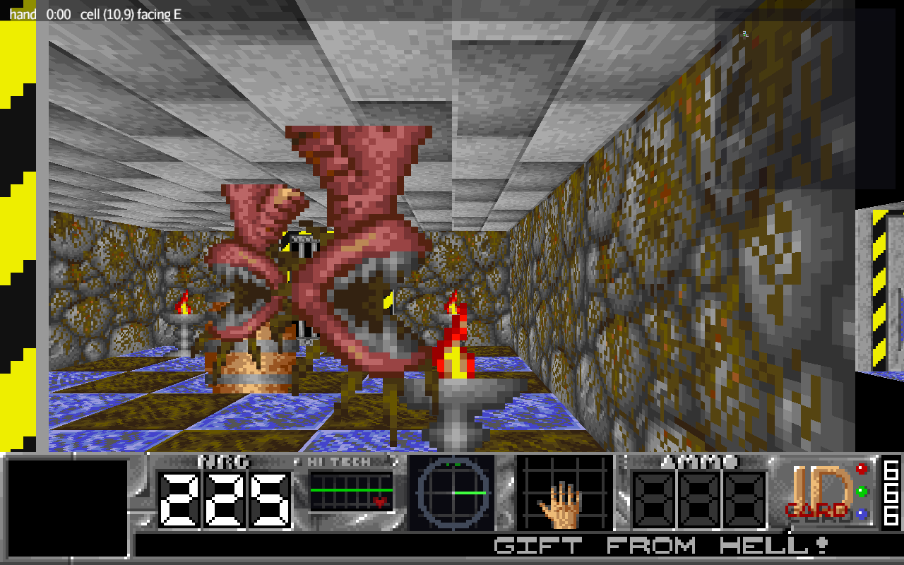
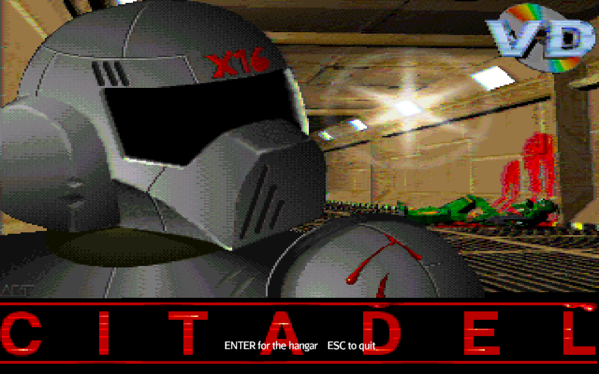
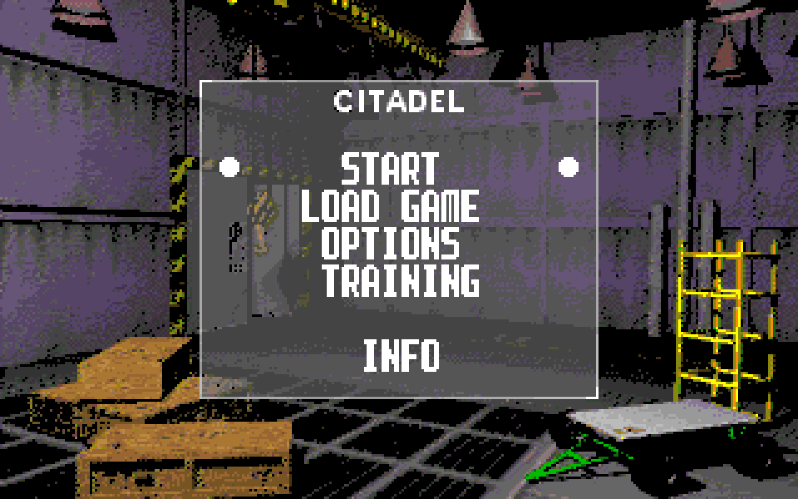
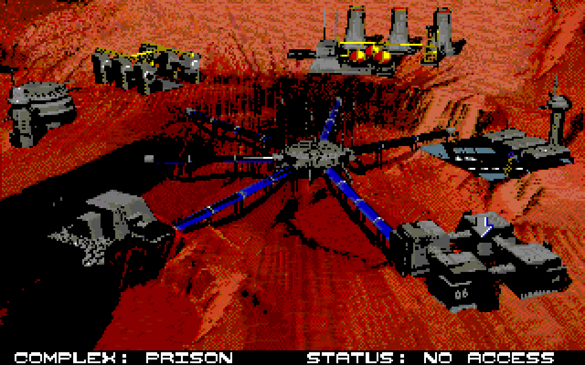
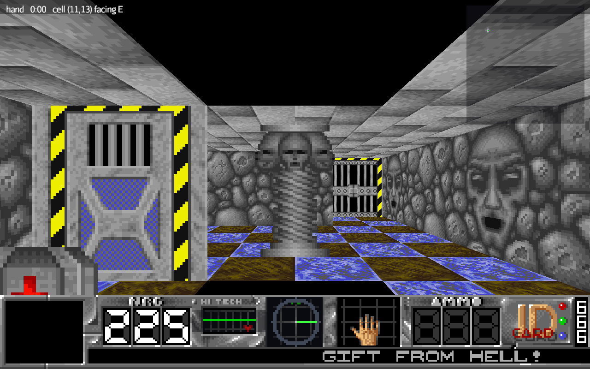
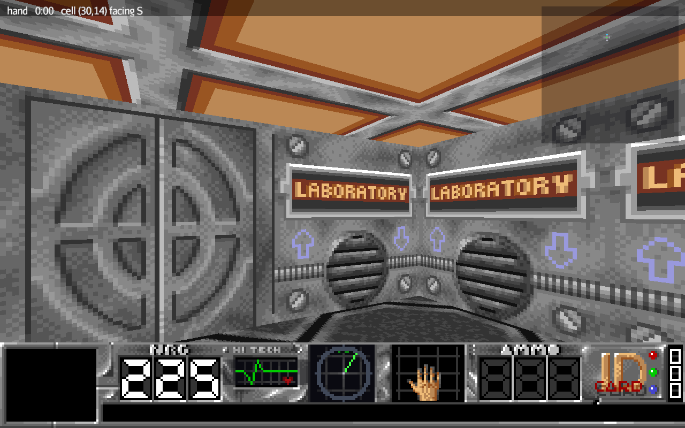
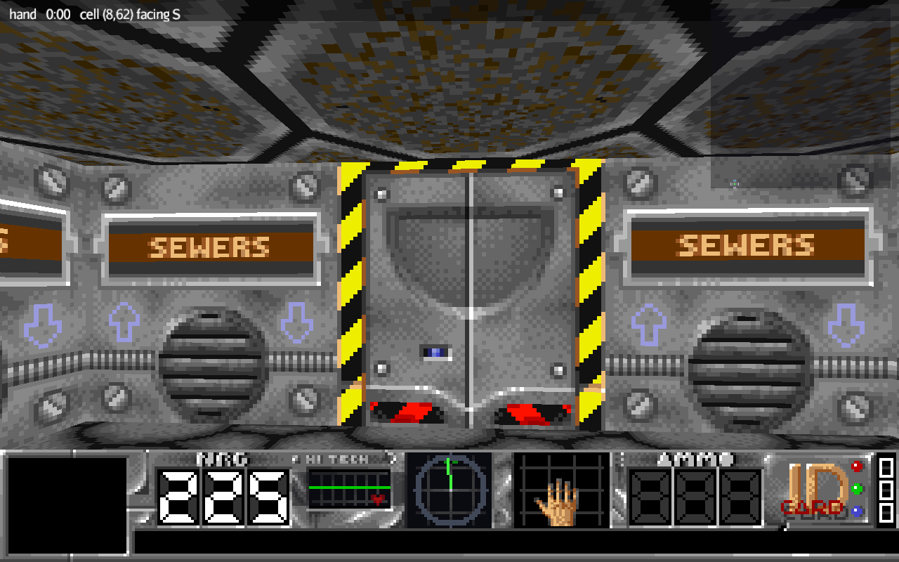
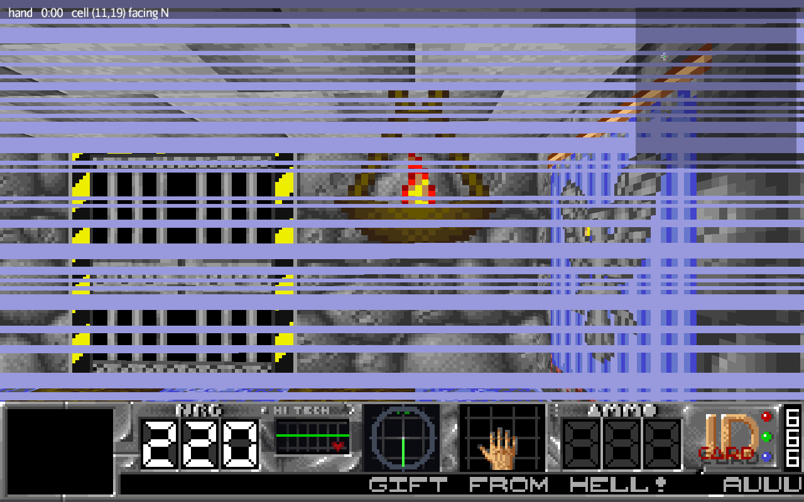
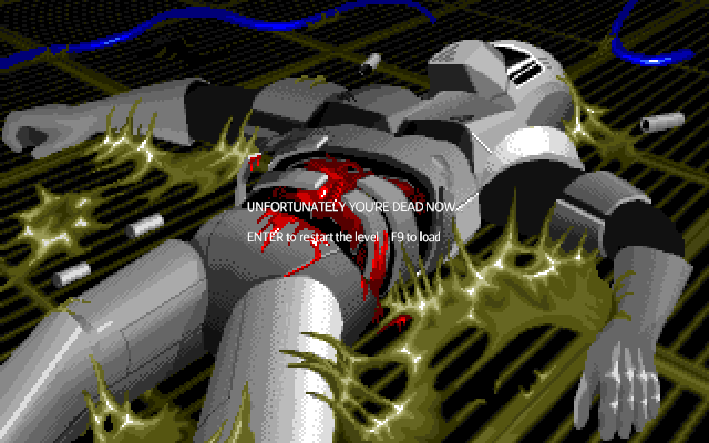
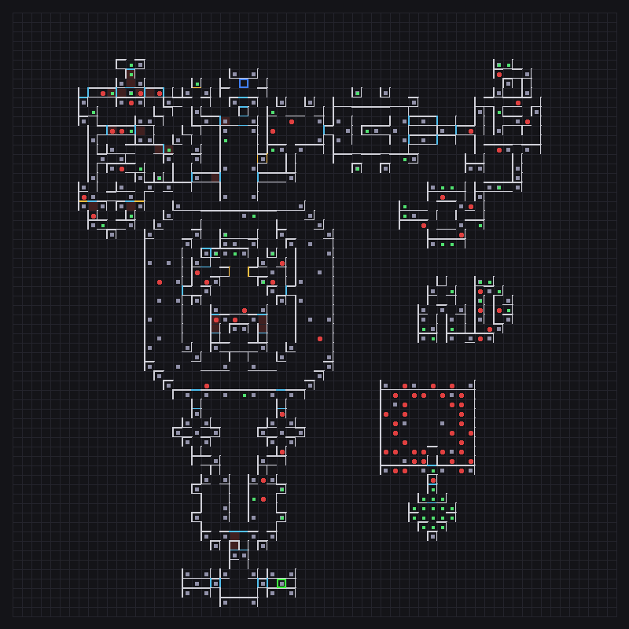

# Citadel — Java / jMonkeyEngine port

A port of the 1995 Amiga first-person shooter **Citadel** by Virtual Design, rebuilt in Java on
[jMonkeyEngine](https://jmonkeyengine.org/). Every rule, table and data format comes from the
original 68000 assembly rather than being reinvented; only the renderer is new.



The original is a cell-based software renderer: a 64 × 64 grid of 1024-unit cells, walls drawn as
textured trapezoids back to front from a precomputed visibility table, all integer arithmetic,
output as chunky pixels and converted to five Amiga bitplanes. The port drops that rendering path
entirely — jMonkeyEngine draws real 3D — and keeps what actually matters: the data formats and the
game rules.

## Screenshots

<table>
  <tr>
    <td></td>
    <td></td>
  </tr>
  <tr>
    <td align="center"><sub>The cover picture the intro ends on</sub></td>
    <td align="center"><sub>The server's menu, in its own font, over the hangar</sub></td>
  </tr>
  <tr>
    <td></td>
    <td></td>
  </tr>
  <tr>
    <td align="center"><sub>MAPA, choosing the next complex to attack</sub></td>
    <td align="center"><sub>A column of skulls, a carved face and a first aid kit</sub></td>
  </tr>
  <tr>
    <td></td>
    <td></td>
  </tr>
  <tr>
    <td align="center"><sub>The laboratory: each complex has its own texture set</sub></td>
    <td align="center"><sub>The sewers</sub></td>
  </tr>
  <tr>
    <td></td>
    <td></td>
  </tr>
  <tr>
    <td align="center"><sub>The interference burst when a shot lands</sub></td>
    <td align="center"><sub>The death sequence's first picture</sub></td>
  </tr>
</table>

## Playing

### From a package

`gradle :game:jpackage` builds a self-contained folder with its own Java runtime (see
[Packaging](#packaging)). It holds no game data: on first start it looks for the five original
Citadel disks as `.adf` images, and offers to download them or to point at a folder that holds
them.

### From source

Needs a JDK 21 toolchain and the five original disk images, which are not part of this
repository: put the `.adf` files in `../adf`, or point the build elsewhere with `-Padf=<path>`.
Their names do not matter, each disk is recognised by its boot block. Gradle downloads
jMonkeyEngine on first build.

```sh
gradle :game:run                   # the cover, then the server's menu in the hangar
gradle :game:run --args=LEVEL05B   # or straight into a level, and on through the campaign
```

Nothing is converted ahead of time: maps, graphics, palettes, sounds, fonts and screens are read
off the disks and decoded in memory as the game needs them (see `citadel.core.disk`). The
Amiga-Citadel sources, as a sibling checkout in `../Amiga-Citadel` (or `-Poriginal=<path>`), are
only needed by the tools and by the tests that hold the disks against the repository's `Data/`.

### Controls

| key | action |
|---|---|
| mouse | turn |
| `W` `S` / `A` `D` | walk / strafe |
| `E`, right mouse button | use the wall you are facing |
| left mouse button, `Ctrl` | fire |
| `1` … `6`, `0` | pick a weapon, back to the bare hand |
| `7`, `8`, `9` | take the red, green or blue card in hand; fire it at a card reader |
| `M` | automap |
| `Z` | interference off |
| `P` | pause |
| `Esc` | leave the level for the hangar, as the original does |
| `-` `+` | game pace |
| `F5` / `F9` | quick save / load, a port extra (see below) |

In the server's screens the arrows (or W/S/A/D) move, and ENTER, SPACE, ESC or a mouse button
picks, which is what SERVER's keyboard handler does with them. ESC on the cover picture quits.

The original's seven cheat codes work too; [PORTING.md](PORTING.md#the-cheat-codes) explains how
they were recovered from the obfuscated tables.

## What works

- **The world** — all 28 levels and all 8 complexes: walls, sliding doors, floors, ceilings,
  animated walls and columns, blood stains and plaques, items and both enemy species.
- **Movement** follows the original rules, not a physics engine: the 307-unit player radius,
  clamp-after-move sliding, corner handling, blocking columns, and the energy it costs to walk
  into a wall.
- **Doors and switches** — doors open as you approach and shut behind you; wall switches run
  their command lists; teleports dissolve the view with the original chaos table.
- **Combat** — enemies roam, close in, respect line of sight and shoot back; weapons fire hitscan
  or real projectiles (fireballs, electricity, rockets that burst into fireballs), with ammunition,
  weapon wear and the per-species vulnerability mask.
- **Inventory** — weapons, ammunition, keycards, first aid, speed boost, vodka, and the six
  warhead sections with their assembly gauge.
- **Status panel** — the original panel with every widget where the engine puts it: energy,
  heart monitor and the exhaustion behind it, compass, weapon reveal, ammunition, ID cards, and
  the scrolling message line with the original texts.
- **The front end** — SERVER's own flow, run as the script it is: the server's menu in the
  hangar (with its panel dissolve, flashing cursor and options), LOAD GAME, TRAINING, the
  scrolling credits, MAPA between complexes, the end-of-level report with its offer to save,
  the death sequence and GAME OVER, and the end: three animations and the scrolling epilogue.
- **Sound** — the 25 effects, positioned in the world for doors and enemies, and the five
  ProTracker songs the server plays, rendered by a ProTracker player in `core`.
- **Saves** — `Savegame.DAT` byte for byte: STRUCTURE copied into a slot after a level, as
  ENDLEVEL_PART does, and loaded from the hangar's LOAD GAME. F5 and F9 add a quick save and
  load the original does not have: F5 writes the slot ENDLEVEL_PART would have written before
  this level, so loading it starts the level over.

Not done yet: the intro (the animations are on disks 1 to 3 but stitched together by the intro
player's own loads), and the pushes that go with a hit (`sv_AddMove` and the `sv_LastMove`
rebound). [PORTING.md](PORTING.md#state) keeps the full list.

## How it is built

| module | contents | dependencies |
|---|---|---|
| `core` | data formats, level model, game rules | none |
| `tools` | exporter and inspectors, for checking the formats | `core`, `java.desktop` |
| `game` | jMonkeyEngine front end | `core`, jME 3.9 |

`core` has no dependency on jMonkeyEngine or on `java.desktop`, so the whole rule set runs
headless. `gradle :core:test` exercises it against the shipped maps, including a random walk of
20 000 steps across five levels asserting the player never ends up on the far side of a shut door.



The exporter (`gradle :tools:convert`, which reads Amiga-Citadel's `Data/`) writes a readable
dump and an overview of every level into `build/assets/maps` — walls in white, doors in blue, switches in amber, columns in grey, items in
green, enemies in red, the spawn as a blue square and the exit as a green one — which is how the
decoding was checked against the game.

Two things were not written down anywhere and had to be worked out: `.VIR` graphics are stored
column-major with a 65-byte stride, and the colour index is bit-reversed into bits 3..7 of each
byte because the chunky-to-planar macro consumes bit 7 first. Cell values index the engine's
sprite tables 1-based.

For verification without a window in the way, `gradle :game:shot` renders one frame to
`build/shots` and exits: `-Plevel=LEVEL03C`,
`-Pscreen=title|hangar|slots|credits|map|endlevel|dead|gameover|victory|epilogue`,
`-Pat=x,y,angle`, `-Pcheat=HOTKISS`, `-Pframe=N` to take it later (the front end advances four
VBLANKs a frame on that path). Every screenshot on this page was made that way.

<br clear="right">

## Packaging

```sh
gradle :game:jpackage              # a self-contained folder in game/build/jpackage/Citadel
gradle :game:jpackage -Ptype=msi   # a Windows installer, which needs the WiX toolset
```

The result carries its own Java runtime and the game, but no game data: about 80 MB, most of it
the runtime. Two things keep that from being twice the size — `--add-modules` so jlink strips the
JDK down to what jME actually uses, and dropping the LWJGL natives for every platform except the
one being built for.

On first start the game asks whether to download the five disk images (a zip of about 4 MB from
amiga500archive.com), or to use a folder that already holds them. It keeps the downloaded disks
and the save file in a per-user folder:
`%LOCALAPPDATA%\Citadel` on Windows, `~/Library/Application Support/Citadel` on macOS,
`~/.local/share/citadel` elsewhere. Delete that folder to start over.

## Documentation

- **[PORTING.md](PORTING.md)** — coordinate system, movement rules, every ported routine with the
  assembly labels it comes from, where the port deliberately departs from the original, and the
  current state.
- **[tools/README.md](tools/README.md)** — every original data format, decoded, with the assembly
  label that proves each claim.

## Legal Notice & Game Assets

### Independent Engine Implementation

This project is an independent reimplementation of the *Citadel* engine, designed to reproduce the original game's behavior on modern platforms.

The engine has been developed from the original source code, published by Virtual Design under the GNU GPL-3.0 ([pawelmat/Amiga-Citadel](https://github.com/pawelmat/Amiga-Citadel)), through technical analysis and compatibility testing. That source code is not included in this repository.

### Original Game Files

This project requires original game files, such as the game's five Amiga ADF disk images, to run.

**Original game files are not included in this project.**

Users must obtain and provide their own game files from a legally authorized source. Before downloading or using this engine, users are required to confirm that they possess a legally obtained copy of the original game.

On first start the game offers to download the five disk images (a zip of about 4 MB from amiga500archive.com) or to point at a folder that holds them.

Eloane Studio does not host, distribute, or provide unauthorized copies of copyrighted game assets.

### Copyright & Trademarks

All original game names, trademarks, graphics, music, and other proprietary assets of *Citadel* remain the property of their respective copyright holders (Virtual Design).

This project is an independent, unofficial implementation and is not affiliated with, endorsed by, or sponsored by the original game's developers or publishers.

### Preservation

The purpose of this project is to preserve the technical behavior and gameplay experience of classic video games while making them accessible on modern systems.

The engine is provided for compatibility, preservation, and educational purposes.

### Credits and licence

Citadel is Copyright © 1995, 2022 Virtual Design. Original code by Kane of Suspect. Java and jMonkeyEngine port by **Guillaume Monet**.

This package is free to copy and use for non-commercial purposes under the terms of the **GNU GPL-3.0** licence; see [LICENSE](LICENSE). It comes with absolutely no warranty of any kind.

<details>
<summary>Version française</summary>

### Mentions légales et données du jeu

#### Implémentation indépendante du moteur

Ce projet est une réimplémentation indépendante du moteur de *Citadel*, conçue pour reproduire le comportement du jeu d'origine sur les plateformes modernes.

Le moteur a été développé à partir du code source d'origine, publié par Virtual Design sous licence GNU GPL-3.0 ([pawelmat/Amiga-Citadel](https://github.com/pawelmat/Amiga-Citadel)), par analyse technique et tests de compatibilité. Ce code source n'est pas inclus dans ce dépôt.

#### Fichiers du jeu d'origine

Ce projet nécessite des fichiers du jeu d'origine, comme les cinq disquettes du jeu (images ADF), pour fonctionner.

**Les fichiers du jeu d'origine ne sont pas inclus dans ce projet.**

Chaque utilisateur doit se procurer et fournir ses propres fichiers de jeu auprès d'une source légalement autorisée. Avant de télécharger ou d'utiliser ce moteur, l'utilisateur doit confirmer qu'il possède une copie du jeu d'origine obtenue légalement.

Au premier lancement, le jeu propose de télécharger les cinq disquettes (une archive d'environ 4 Mo sur amiga500archive.com) ou d'indiquer un dossier qui les contient.

Eloane Studio n'héberge, ne distribue ni ne fournit de copies non autorisées de données de jeu protégées par le droit d'auteur.

#### Droits d'auteur et marques

Les noms, marques, graphismes, musiques et autres éléments propriétaires de *Citadel* restent la propriété de leurs titulaires respectifs (Virtual Design).

Ce projet est une implémentation indépendante et non officielle ; il n'est ni affilié, ni approuvé, ni soutenu par les développeurs ou les éditeurs du jeu d'origine.

#### Préservation

Ce projet a pour but de préserver le comportement technique et l'expérience de jeu des jeux vidéo classiques, tout en les rendant accessibles sur les systèmes modernes.

Le moteur est fourni à des fins de compatibilité, de préservation et d'éducation.

#### Crédits et licence

Citadel est Copyright © 1995, 2022 Virtual Design. Code d'origine de Kane of Suspect. Portage Java et jMonkeyEngine : **Guillaume Monet**.

Ce paquet peut être copié et utilisé librement à des fins non commerciales, selon les termes de la licence **GNU GPL-3.0** ; voir [LICENSE](LICENSE). Il est fourni sans aucune garantie.

</details>
