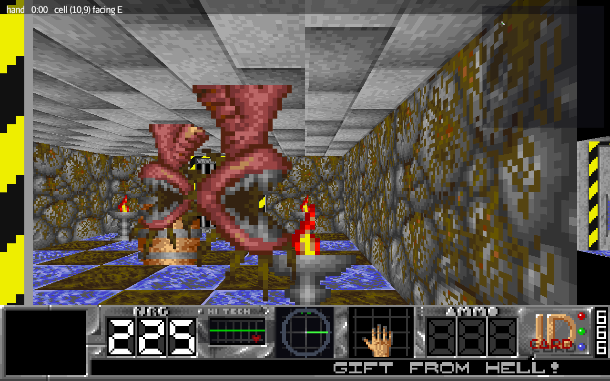
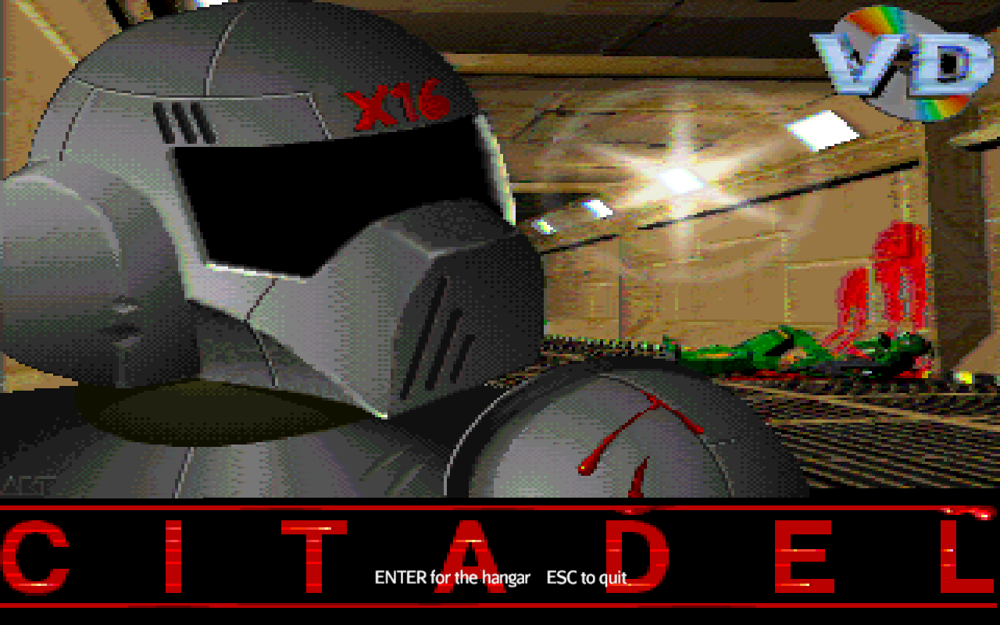
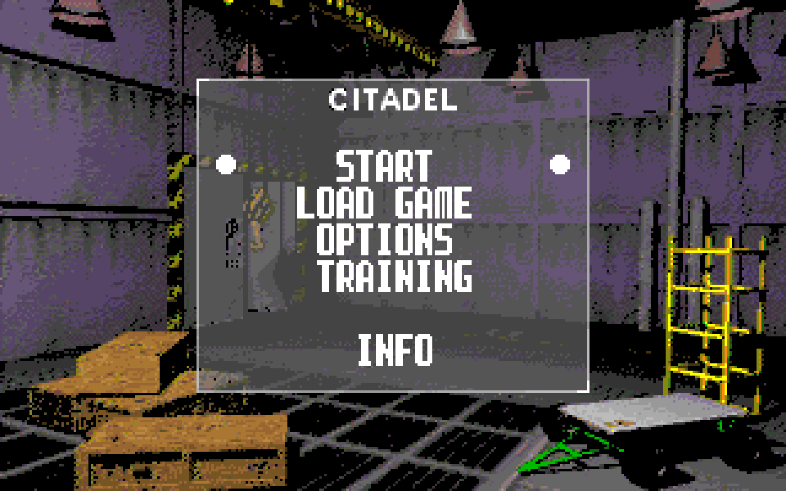
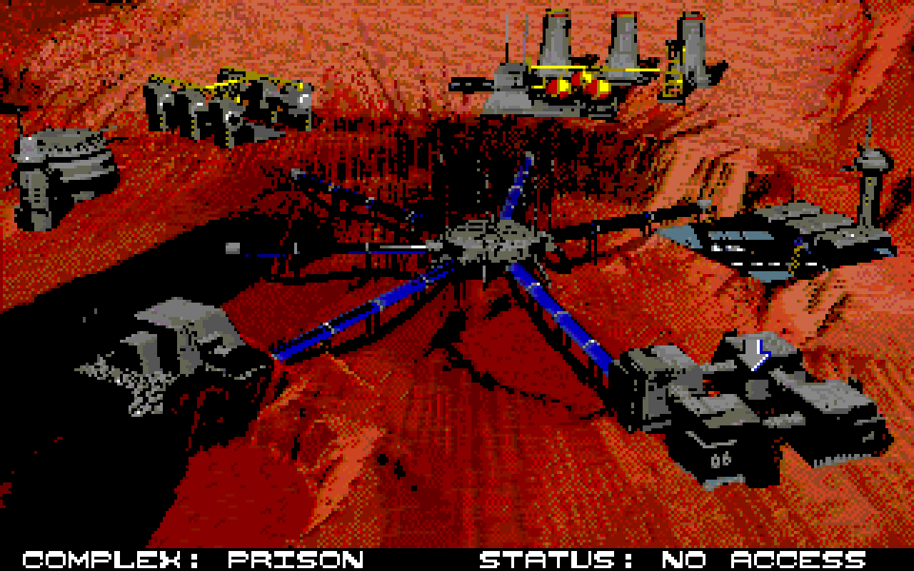
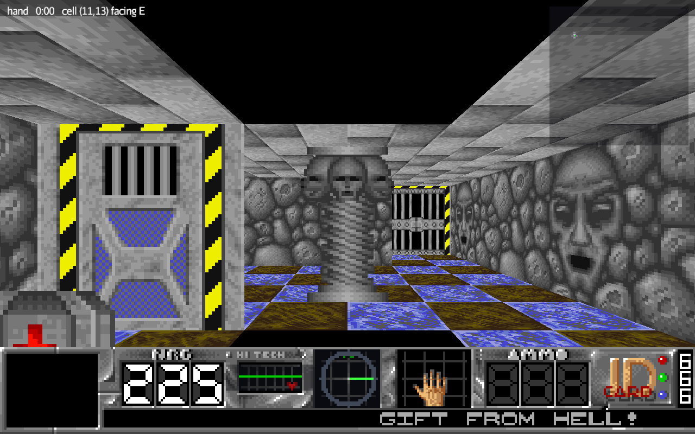
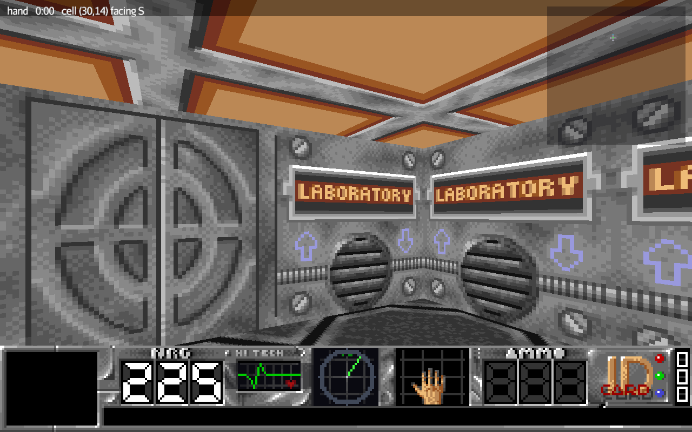
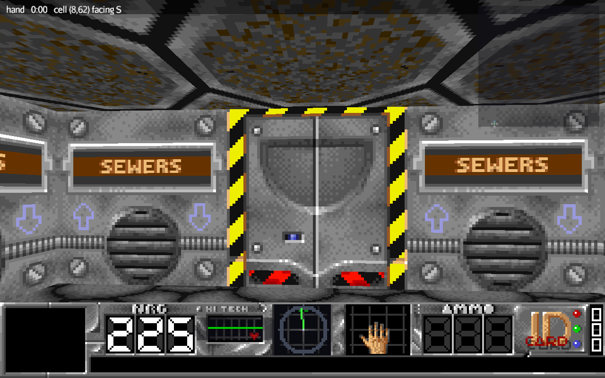
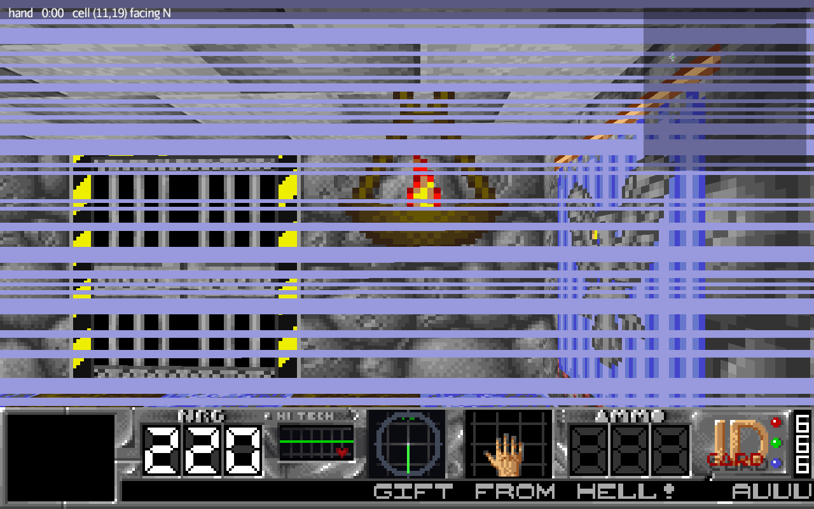
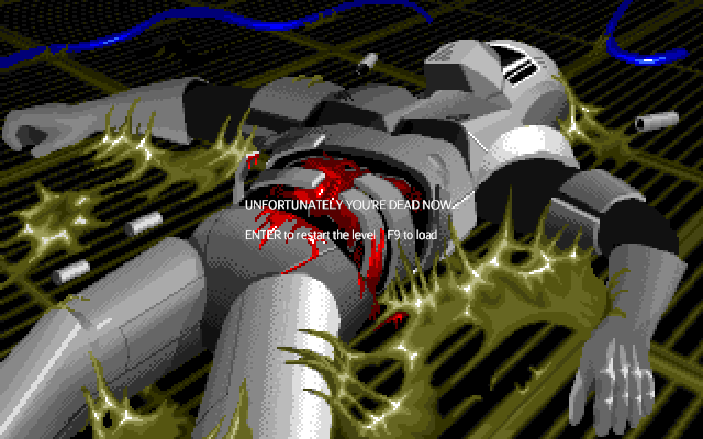
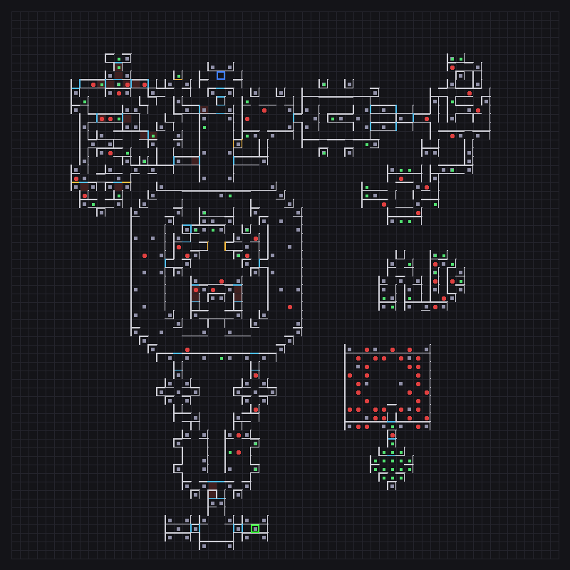

# Citadel — portage Java / jMonkeyEngine

*[English version](README.md)*

Un portage du jeu de tir à la première personne **Citadel**, sorti sur Amiga en 1995 et signé Virtual Design, reconstruit en Java sur
[jMonkeyEngine](https://jmonkeyengine.org/). Chaque règle, chaque table et chaque format de données vient de
l'assembleur 68000 d'origine au lieu d'être réinventé ; seul le moteur de rendu est nouveau.



L'original est un moteur de rendu logiciel à base de cellules : une grille de 64 × 64 cellules de 1024 unités, des murs dessinés
comme des trapèzes texturés de l'arrière vers l'avant à partir d'une table de visibilité précalculée, tout en arithmétique entière,
avec une sortie en pixels chunky convertie en cinq bitplanes Amiga. Le portage abandonne entièrement ce chemin de rendu
— jMonkeyEngine dessine en vraie 3D — et garde ce qui compte vraiment : les formats de données et les
règles du jeu.

## Captures d'écran

<table>
  <tr>
    <td></td>
    <td></td>
  </tr>
  <tr>
    <td align="center"><sub>L'image de couverture sur laquelle se termine l'intro</sub></td>
    <td align="center"><sub>Le menu du serveur, dans sa propre police, sur fond de hangar</sub></td>
  </tr>
  <tr>
    <td></td>
    <td></td>
  </tr>
  <tr>
    <td align="center"><sub>MAPA, le choix du prochain complexe à attaquer</sub></td>
    <td align="center"><sub>Une colonne de crânes, un visage sculpté et une trousse de premiers secours</sub></td>
  </tr>
  <tr>
    <td></td>
    <td></td>
  </tr>
  <tr>
    <td align="center"><sub>Le laboratoire : chaque complexe a son propre jeu de textures</sub></td>
    <td align="center"><sub>Les égouts</sub></td>
  </tr>
  <tr>
    <td></td>
    <td></td>
  </tr>
  <tr>
    <td align="center"><sub>La salve d'interférences quand un tir porte</sub></td>
    <td align="center"><sub>La première image de la séquence de mort</sub></td>
  </tr>
</table>

## Jouer

### Depuis un paquet

`gradle :game:jpackage` construit un dossier autonome avec son propre environnement d'exécution Java (voir
[Empaquetage](#empaquetage)). Il ne contient aucune donnée du jeu : au premier lancement, il cherche les cinq disquettes
originales de Citadel sous forme d'images `.adf`, et propose de les télécharger ou d'indiquer un dossier qui
les contient.

### Depuis les sources

Il faut une chaîne d'outils JDK 21 et les cinq images disque d'origine, qui ne font pas partie de ce
dépôt : placez les fichiers `.adf` dans `../adf`, ou indiquez un autre emplacement au build avec `-Padf=<path>`.
Leurs noms n'ont pas d'importance, chaque disquette est reconnue par son bloc d'amorce. Gradle télécharge
jMonkeyEngine lors du premier build.

```sh
gradle :game:run                   # la couverture, puis le menu du serveur dans le hangar
gradle :game:run --args=LEVEL05B   # ou directement dans un niveau, puis la suite de la campagne
```

Rien n'est converti à l'avance : cartes, graphismes, palettes, sons, polices et écrans sont lus
sur les disquettes et décodés en mémoire au fur et à mesure que le jeu en a besoin (voir `citadel.core.disk`). Les
sources d'Amiga-Citadel, extraites à côté dans `../Amiga-Citadel` (ou `-Poriginal=<path>`), ne
servent qu'aux outils et aux tests qui confrontent les disquettes au répertoire `Data/` du dépôt.

### Commandes

| touche | action |
|---|---|
| souris | tourner |
| `W` `S` / `A` `D` | marcher / pas de côté |
| `E`, bouton droit de la souris | utiliser le mur qui vous fait face |
| bouton gauche de la souris, `Ctrl` | tirer |
| `1` … `6`, `0` | choisir une arme, revenir à mains nues |
| `7`, `8`, `9` | prendre en main la carte rouge, verte ou bleue ; la « tirer » sur un lecteur de carte |
| `M` | carte automatique |
| `Z` | désactiver les interférences |
| `P` | pause |
| `Esc` | quitter le niveau pour le hangar, comme dans l'original |
| `-` `+` | vitesse du jeu |
| `F5` / `F9` | sauvegarde / chargement rapide, un ajout du portage (voir plus bas) |

Dans les écrans du serveur, les flèches (ou W/S/A/D) déplacent la sélection, et ENTRÉE, ESPACE, ÉCHAP ou un bouton de la souris
valident, ce qui correspond à ce qu'en fait le gestionnaire clavier de SERVER. ÉCHAP sur l'image de couverture quitte le jeu.

Les sept codes de triche de l'original fonctionnent aussi ; [PORTING.md](PORTING.md#the-cheat-codes) (en anglais) explique comment
ils ont été retrouvés à partir des tables obfusquées.

## Ce qui fonctionne

- **Le monde** — les 28 niveaux et les 8 complexes : murs, portes coulissantes, sols, plafonds,
  murs et colonnes animés, taches de sang et plaques, objets et les deux espèces d'ennemis.
- **Le déplacement** suit les règles d'origine, pas un moteur physique : le rayon de 307 unités du joueur,
  le glissement par correction après déplacement, la gestion des coins, les colonnes bloquantes, et l'énergie que coûte le fait de marcher
  contre un mur.
- **Portes et interrupteurs** — les portes s'ouvrent à votre approche et se referment derrière vous ; les interrupteurs muraux exécutent
  leurs listes de commandes ; les téléporteurs dissolvent la vue avec la table de chaos d'origine.
- **Combat** — les ennemis errent, se rapprochent, respectent la ligne de vue et ripostent ; les armes tirent en hitscan
  ou de vrais projectiles (boules de feu, électricité, roquettes qui éclatent en boules de feu), avec munitions,
  usure des armes et masque de vulnérabilité propre à chaque espèce.
- **Inventaire** — armes, munitions, cartes d'accès, premiers secours, bonus de vitesse, vodka, et les six
  sections de l'ogive avec leur jauge d'assemblage.
- **Panneau d'état** — le panneau d'origine avec chaque élément là où le moteur le place : énergie,
  moniteur cardiaque et l'épuisement qu'il traduit, boussole, affichage de l'arme, munitions, cartes d'identité, et
  la ligne de messages défilante avec les textes d'origine.
- **L'interface** — le déroulement propre à SERVER, exécuté comme le script qu'il est : le menu du serveur dans le
  hangar (avec la dissolution de son panneau, son curseur clignotant et ses options), LOAD GAME, TRAINING, le
  générique défilant, MAPA entre les complexes, le bilan de fin de niveau avec sa proposition de sauvegarde,
  la séquence de mort et GAME OVER, et la fin : trois animations et l'épilogue défilant.
- **Son** — les 25 effets, positionnés dans le monde pour les portes et les ennemis, et les cinq
  morceaux ProTracker que joue le serveur, rendus par un lecteur ProTracker dans `core`.
- **Sauvegardes** — `Savegame.DAT` octet pour octet : STRUCTURE copiée dans un emplacement après un niveau, comme
  le fait ENDLEVEL_PART, et chargée depuis le LOAD GAME du hangar. F5 et F9 ajoutent une sauvegarde et un
  chargement rapides que l'original n'a pas : F5 écrit l'emplacement qu'ENDLEVEL_PART aurait écrit avant
  ce niveau, si bien que le charger recommence le niveau.

Pas encore fait : l'intro (les animations sont sur les disquettes 1 à 3, mais assemblées par les propres chargements
du lecteur d'intro), et les poussées qui accompagnent un coup reçu (`sv_AddMove` et le rebond `sv_LastMove`).
[PORTING.md](PORTING.md#state) (en anglais) tient la liste complète.

## Comment il est construit

| module | contenu | dépendances |
|---|---|---|
| `core` | formats de données, modèle de niveau, règles du jeu | aucune |
| `tools` | exportateur et inspecteurs, pour vérifier les formats | `core`, `java.desktop` |
| `game` | interface jMonkeyEngine | `core`, jME 3.9 |

`core` ne dépend ni de jMonkeyEngine ni de `java.desktop`, si bien que l'ensemble des règles tourne
sans affichage. `gradle :core:test` les met à l'épreuve sur les cartes fournies, notamment avec une marche aléatoire de
20 000 pas à travers cinq niveaux qui vérifie que le joueur ne se retrouve jamais de l'autre côté d'une porte fermée.



L'exportateur (`gradle :tools:convert`, qui lit le répertoire `Data/` d'Amiga-Citadel) écrit un dump lisible
et une vue d'ensemble de chaque niveau dans `build/assets/maps` — murs en blanc, portes en bleu, interrupteurs en ambre, colonnes en gris, objets en
vert, ennemis en rouge, le point d'apparition sous forme de carré bleu et la sortie sous forme de carré vert — c'est ainsi que le
décodage a été vérifié par rapport au jeu.

Deux choses n'étaient écrites nulle part et ont dû être déduites : les graphismes `.VIR` sont stockés
par colonnes avec un pas de 65 octets, et l'indice de couleur est inversé bit à bit dans les bits 3..7 de chaque
octet, parce que la macro chunky-vers-planar consomme d'abord le bit 7. Les valeurs des cellules indexent les tables de
sprites du moteur à partir de 1.

Pour vérifier sans qu'une fenêtre gêne, `gradle :game:shot` rend une seule image dans
`build/shots` puis s'arrête : `-Plevel=LEVEL03C`,
`-Pscreen=title|hangar|slots|credits|map|endlevel|dead|gameover|victory|epilogue`,
`-Pat=x,y,angle`, `-Pcheat=HOTKISS`, `-Pframe=N` pour la prendre plus tard (l'interface avance de quatre
VBLANK par image sur ce chemin). Toutes les captures d'écran de cette page ont été faites ainsi.

<br clear="right">

## Empaquetage

```sh
gradle :game:jpackage              # un dossier autonome dans game/build/jpackage/Citadel
gradle :game:jpackage -Ptype=msi   # un installateur Windows, qui nécessite le WiX toolset
```

Le résultat embarque son propre environnement d'exécution Java et le jeu, mais aucune donnée du jeu : environ 80 Mo, pour l'essentiel
l'environnement d'exécution. Deux choses évitent qu'il fasse le double — `--add-modules`, pour que jlink réduise le
JDK à ce que jME utilise vraiment, et la suppression des bibliothèques natives LWJGL de toutes les plateformes sauf
celle pour laquelle on construit.

Au premier lancement, le jeu demande s'il faut télécharger les cinq images disque (une archive zip d'environ 4 Mo sur
amiga500archive.com), ou utiliser un dossier qui les contient déjà. Il conserve les disquettes téléchargées
et le fichier de sauvegarde dans un dossier propre à chaque utilisateur :
`%LOCALAPPDATA%\Citadel` sous Windows, `~/Library/Application Support/Citadel` sous macOS,
`~/.local/share/citadel` ailleurs. Supprimez ce dossier pour repartir de zéro.

## Documentation

- **[PORTING.md](PORTING.md)** (en anglais) — système de coordonnées, règles de déplacement, chaque routine portée avec les
  labels assembleur dont elle provient, les endroits où le portage s'écarte délibérément de l'original, et
  l'état actuel.
- **[tools/README.md](tools/README.md)** (en anglais) — chaque format de données d'origine, décodé, avec le label
  assembleur qui prouve chaque affirmation.

## Mentions légales et données du jeu

### Implémentation indépendante du moteur

Ce projet est une réimplémentation indépendante du moteur de *Citadel*, conçue pour reproduire le comportement du jeu d'origine sur les plateformes modernes.

Le moteur a été développé à partir du code source d'origine, publié par Virtual Design sous licence GNU GPL-3.0 ([pawelmat/Amiga-Citadel](https://github.com/pawelmat/Amiga-Citadel)), par analyse technique et tests de compatibilité. Ce code source n'est pas inclus dans ce dépôt.

### Fichiers du jeu d'origine

Ce projet nécessite des fichiers du jeu d'origine, comme les cinq disquettes du jeu (images ADF), pour fonctionner.

**Les fichiers du jeu d'origine ne sont pas inclus dans ce projet.**

Chaque utilisateur doit se procurer et fournir ses propres fichiers de jeu auprès d'une source légalement autorisée. Avant de télécharger ou d'utiliser ce moteur, l'utilisateur doit confirmer qu'il possède une copie du jeu d'origine obtenue légalement.

Au premier lancement, le jeu propose de télécharger les cinq disquettes (une archive d'environ 4 Mo sur amiga500archive.com) ou d'indiquer un dossier qui les contient.

Eloane Studio n'héberge, ne distribue ni ne fournit de copies non autorisées de données de jeu protégées par le droit d'auteur.

### Droits d'auteur et marques

Les noms, marques, graphismes, musiques et autres éléments propriétaires de *Citadel* restent la propriété de leurs titulaires respectifs (Virtual Design).

Ce projet est une implémentation indépendante et non officielle ; il n'est ni affilié, ni approuvé, ni soutenu par les développeurs ou les éditeurs du jeu d'origine.

### Préservation

Ce projet a pour but de préserver le comportement technique et l'expérience de jeu des jeux vidéo classiques, tout en les rendant accessibles sur les systèmes modernes.

Le moteur est fourni à des fins de compatibilité, de préservation et d'éducation.

### Crédits et licence

Citadel est Copyright © 1995, 2022 Virtual Design. Code d'origine de Kane of Suspect. Portage Java et jMonkeyEngine : **Guillaume Monet**.

Ce paquet peut être copié et utilisé librement à des fins non commerciales, selon les termes de la licence **GNU GPL-3.0** ; voir [LICENSE](LICENSE). Il est fourni sans aucune garantie.
